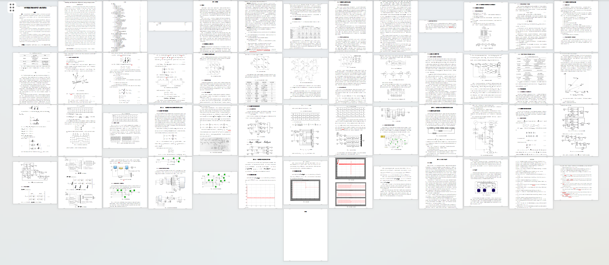

# Modeling and Simulink Simulation of Flywheel Energy Storage System (Permanent Magnet Synchronous Motor as Flywheel Drive Motor)

Modeling and Simulink Simulation of Flywheel Energy Storage System (Permanent Magnet Synchronous Motor as the Flywheel Drive Motor) + Documentation Explanation

## Images

<!-- PAYMENT_BLOCK -->

## Get this dataset

- Payment link (Stripe): [Buy now](https://buy.stripe.com/3cs8yP7sY87d0vu9AB)
- Payment QR code: 

<!-- /PAYMENT_BLOCK -->
